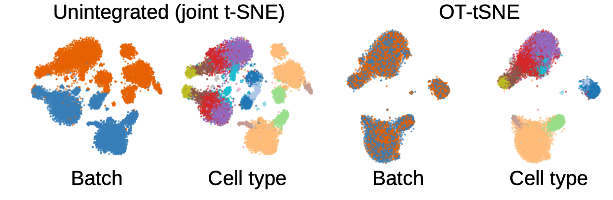
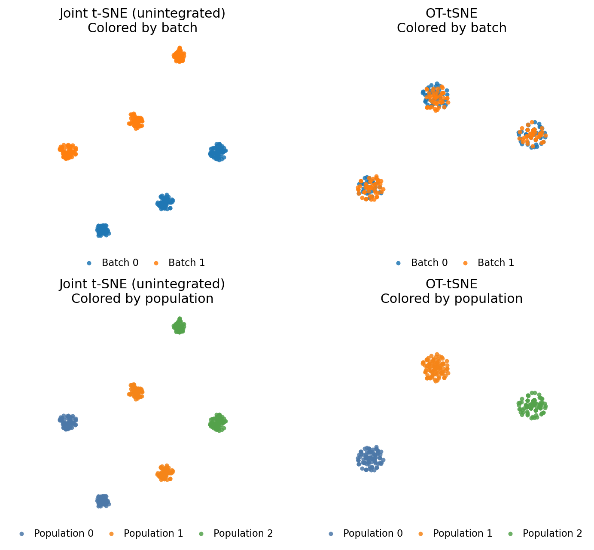
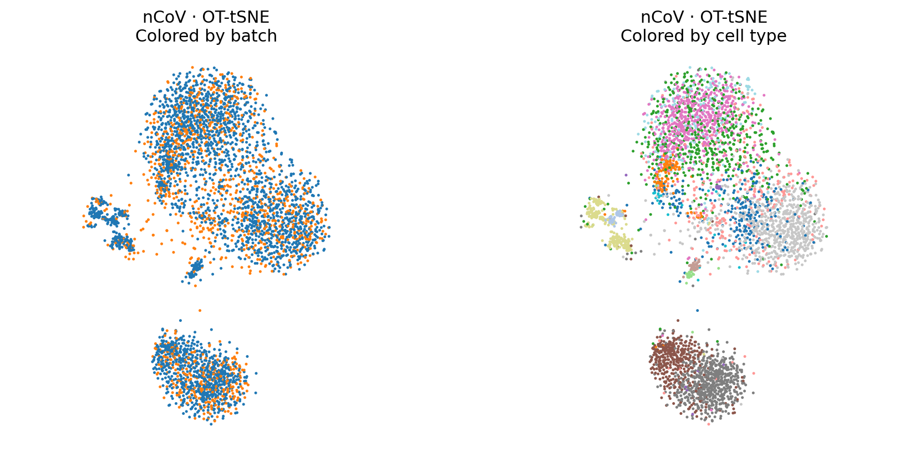
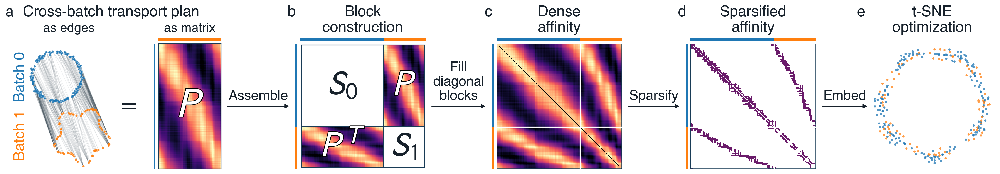

# OT-tSNE

This repository contains the code for the paper **Optimal Transport Meets t-SNE: Integrated
Visualization without Batch Effects in OT-tSNE** (arXiv link).

OT-tSNE (Optimal Transport t-SNE) creates a shared two-dimensional embedding of two datasets
affected by batch effects, the systematic differences that can arise between separately
recorded datasets. It combines optimal transport with t-SNE to align the datasets while
preserving meaningful structure, without requiring paired observations or labels.

<p align="center">
  
</p>

## Installation

Install with [uv](https://docs.astral.sh/uv/):

```bash
git clone https://github.com/azharakhmetova/ot-tsne.git
cd ot-tsne
uv sync --locked
```

## Usage example

The basic usage is to pass two batches to `compute_ot_tsne_embedding_from_arrays`.
Here is an example on a toy dataset consisting of three 3D Gaussian blobs, where one batch is translated along the third coordinate.

```python
from sklearn.datasets import make_blobs

from ne_aligned_utils.methods import compute_ot_tsne_embedding_from_arrays

X, labels = make_blobs(
    n_samples=300,
    centers=[[-4, 0, 0], [0, 4, 0], [4, 0, 0]],
    cluster_std=0.5,
    random_state=0,
)
# create batches
x0, x1 = X[:150].copy(), X[150:].copy()
x1[:, 2] += 6.0

# OT-tSNE
embedding = compute_ot_tsne_embedding_from_arrays(
    x0, x1,
    rel_reg=1.0,
    effective_k=15,
    random_state=0,
    n_jobs=4,
)
```

To run the [example](examples/toy.py):

```bash
uv run python examples/toy.py
```

<p align="center">
  
</p>

Inputs are arrays with shapes `(n0, d)` and `(n1, d)`. The result has shape
`(n0 + n1, 2)`: `embedding[:n0]` belongs to the first batch and `embedding[n0:]` to the second.

### Main parameters

| Parameter | Default | Meaning |
|---|---|---|
| `rel_reg` | `1.0` | Entropic regularization relative to the median squared cross-batch distance: `epsilon = rel_reg * median_squared_distance`. Smaller values sharpen the transport plan. |
| `effective_k` | `15` | Neighbor-selection budget per observation, divided between batches in proportion to their sizes. Symmetrization can increase the final degree. |
| `random_state` | `0` | Seed for the embedding. |
| `n_jobs` | `1` | Number of threads for the t-SNE stage. |
| `device` | `"cpu"` | OT solver device. `"cuda"` uses a CUDA-capable PyTorch installation for transport; the t-SNE layout still runs on the CPU. |

The default t-SNE schedule uses 250 early-exaggeration iterations followed by 500 main
iterations. The graph is supplied directly, so `effective_k` controls its neighborhood
budget in place of t-SNE's usual perplexity-based affinity construction.

### Single-cell data example

We benchmark OT-tSNE on single-cell integration tasks. Here we use the nCoV dataset from
[Zhu et al. (2020)](https://doi.org/10.1016/j.immuni.2020.07.009), containing 4,117 PBMCs
from patient 5 at days 1 and 13. The checkout includes preprocessed inputs: 50-dimensional
scores from a PCA fitted jointly to both batches.

```text
data/nCoV/preprocessed/
├── X1_pca50.npy           # 2,877 cells × 50 joint PCs (day 13)
├── X2_pca50.npy           # 1,240 cells × 50 joint PCs (day 1)
```

Load the PCA scores and pass the two batches directly to OT-tSNE:

```python
from pathlib import Path

import numpy as np

from ne_aligned_utils.methods import compute_ot_tsne_embedding_from_arrays

data_dir = Path("data/nCoV/preprocessed")
x0 = np.load(data_dir / "X1_pca50.npy")
x1 = np.load(data_dir / "X2_pca50.npy")
embedding = compute_ot_tsne_embedding_from_arrays(
    x0, x1, rel_reg=1.0, effective_k=15, random_state=0, n_jobs=4,
)
```

The [example script](examples/ncov.py) generates the figure below.

<p align="center">
  
</p>

### Using your own data

OT-tSNE can be used with any data represented in a shared numerical feature space;
it is not restricted to single-cell data. Both batches may contain different numbers of observations.
The current implementation supports two batches and uses Euclidean distances. Paired observations and labels are not required. For your own data, supply preprocessed features or scores from a shared PCA.


## Method

<p align="center">
  
</p>

1. **Match across batches.** Compute a balanced entropic optimal-transport plan from
   squared Euclidean distances between the two batches.
2. **Build a joint affinity matrix.** Use the plan for cross-batch affinities and its
   singular vectors and singular values to construct within-batch affinities. Observations
   are similar within a batch when their transport relationships to the other batch are similar.
3. **Select neighbors.** Retain the strongest affinities under a fixed neighbor budget,
   split proportionally between batches. By default, an edge is kept if either endpoint
   selects it; retained edges receive equal weight and the graph is normalized.
4. **Embed.** Optimize a two-dimensional t-SNE layout of this graph using
   [openTSNE](https://github.com/pavlin-policar/openTSNE).

Optimal transport is computed with [POT](https://pythonot.github.io/). The worked example
uses the main OT-tSNE method (`ot` in the benchmark). Alternative within-batch constructions,
including kNN, Gram, self-OT, and zero-diagonal variants, are provided for the paper's
comparisons in [the method implementations](src/ne_aligned_utils/methods/ot_methods.py).

## Notebooks

The two MNIST walkthroughs explore how the direction and magnitude of a batch effect 
change cross-batch matching and the resulting embeddings:

| Notebook | What it explores |
|---|---|
| [Orthogonal batch effects](notebooks/mnist_orthogonal_batch_effect_walkthrough.ipynb) | Perturbations in PCA-tail directions, comparing the original and signal-projected representations through transport diagnostics, neighbor graphs, and embeddings. |
| [Parallel batch effects](notebooks/mnist_parallel_batch_effect_walkthrough.ipynb) | Opposite shifts along the leading principal component, using constant or digit-dependent shift magnitudes. |

## Repository structure

```text
src/ne_aligned_utils/
  methods/
    ot_methods.py          OT-tSNE entry points and variants
    ot_transport.py        Entropic optimal-transport plans
    ot_affinity.py         Affinity construction and neighbor selection
    ot_graph.py            Graph initialization and t-SNE optimization
examples/                  Runnable toy and nCoV examples
notebooks/                 Synthetic experiments and figures
data/nCoV/preprocessed/     Prepared nCoV example inputs
```

## Citation

Code for the analyses presented in the paper, including the benchmark and figures, is
also included. See the [reproduction guide](reproduction/README.md) for setup and execution
instructions.
<!-- Add the selected code license and link to a root LICENSE file before public release. -->
